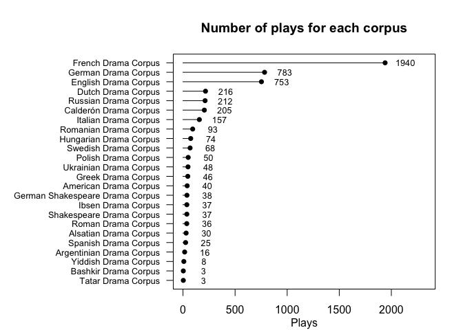
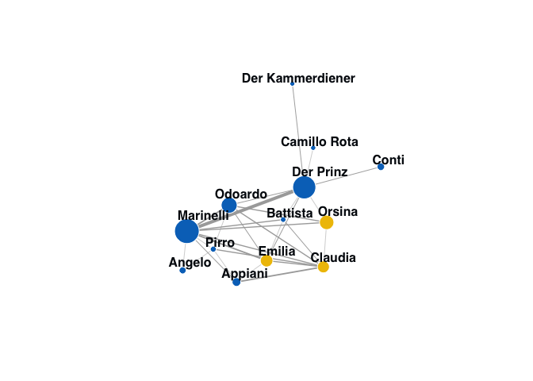
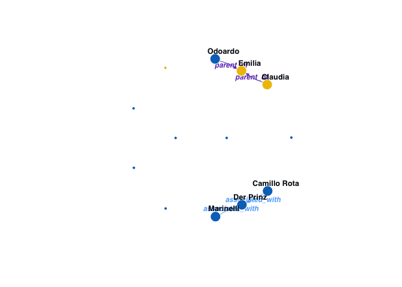

<!-- README.md is generated from README.Rmd. Please edit that file -->

# rdracor 

<!-- badges: start -->

<!-- badges: end -->

**Authors:** Ivan Pozdniakov, Frank Fischer<br /> **License:** GPL-3

The goal of **rdracor** is to provide an R interface for the [DraCor
API](https://dracor.org/documentation/api) (DraCor: Drama Corpora
Project). Website of the project: [dracor.org](https://dracor.org).

## Installation

Installation from CRAN:

``` r
install.packages("rdracor")
```

If you wish to install the current build of the next release you can do
so using the following:

    # install.packages("remotes")
    remotes::install_github("dracor-org/rdracor")

``` r
library(rdracor)
```

## Select DraCor API

DraCor API has several versions. By default, it utilizes the main
branch:

``` r
get_dracor_api_url()
#> [1] "https://dracor.org/api/v1"
```

You can set DraCor URL API of your choice:

``` r
set_dracor_api_url("https://staging.dracor.org/api/v1")
```

## Slow or unavailable API

All functions of the package request data from DraCor API. If the API
cannot be reached (no internet connection, the server is down or does
not respond), they do not throw an error: they show an informative
message and return `NULL`. You can check whether the API responds:

``` r
dracor_api_available()
#> [1] TRUE
```

Two time limits apply to every request, both can be changed with
`options()`:

- `rdracor.connect_timeout` — seconds to wait for the server to accept
  the connection (30 by default);
- `rdracor.timeout` — seconds to wait for the whole response (600 by
  default).

Increase them if your connection is slow, e.g.:

``` r
options(rdracor.timeout = 1800)
```

## General info on corpora

Retrieving general information about available corpora:

``` r
corpora <- get_dracor_meta()
summary(corpora)
#> DraCor hosts 24 corpora comprising 4918 plays.
#> 
#> The last updated corpus was German Drama Corpus (2026-10-07 01:32:39.834).
plot(corpora)
```



## Plays in the corpus

``` r
ger <- get_dracor(corpus = "ger")
summary(ger)
#> 783 plays in German Drama Corpus
#> Corpus id: ger, repository: https://github.com/dracor-org/gerdracor
#> Description: Edited by Frank Fischer and Peer Trilcke. Features more than 750 German-language plays from the 1500s to the 1940s. For a corpus description and full credits please see the [README on GitHub](https://github.com/dracor-org/gerdracor).
#> Written years (range): 1549–1947
#> Premiere years (range): 1515–2023
#> Years of the first printing (range): 1510–2010
```

You can get all corpora at once:

``` r
all <- get_dracor()
summary(all)
#> 4930 plays in 24 corpora:
#> Corpora id:
#> fre (1940 plays), ger (783 plays), eng (753 plays), dutch (228 plays), rus (212 plays), cal (205 plays), ita (157 plays), ro (93 plays), hun (74 plays), swe (68 plays), pol (50 plays), u (48 plays), greek (46 plays), am (40 plays), gersh (38 plays), ibs (37 plays), shake (37 plays), rom (36 plays), als (30 plays), span (25 plays), ar (16 plays), yi (8 plays), bash (3 plays), tat (3 plays)
#> Written years (range): 43–1970
#> Premiere years (range): -497–2023
#> Years of the first printing (range): 1170–2017
```

## Play metadata

With `get_play_metadata()` you can get miscellaneous data for a play:

``` r
get_play_metadata(play = "lessing-emilia-galotti", 
                  corpus = "ger",
                  full_metadata = FALSE) #use full_metadata = FALSE for faster download 
#> $allInSegment
#> [1] 30
#> 
#> $wikidataId
#> [1] "Q782653"
#> 
#> $segments
#> # A tibble: 43 × 4
#>    type  title                              speakers  number
#>    <chr> <chr>                              <list>     <int>
#>  1 scene Erster Aufzug | Erster Auftritt    <chr [2]>      1
#>  2 scene Erster Aufzug | Zweiter Auftritt   <chr [2]>      2
#>  3 scene Erster Aufzug | Dritter Auftritt   <chr [1]>      3
#>  4 scene Erster Aufzug | Vierter Auftritt   <chr [2]>      4
#>  5 scene Erster Aufzug | Fünfter Auftritt   <chr [1]>      5
#>  6 scene Erster Aufzug | Sechster Auftritt  <chr [2]>      6
#>  7 scene Erster Aufzug | Siebenter Auftritt <chr [2]>      7
#>  8 scene Erster Aufzug | Achter Auftritt    <chr [2]>      8
#>  9 scene Zweiter Aufzug | Erster Auftritt   <chr [2]>      9
#> 10 scene Zweiter Aufzug | Zweiter Auftritt  <chr [2]>     10
#> # ℹ 33 more rows
#> 
#> $normalizedGenre
#> [1] "Tragedy"
#> 
#> $subtitle
#> [1] "Ein Trauerspiel in fünf Aufzügen"
#> 
#> $yearPremiered
#> [1] "1772"
#> 
#> $corpus
#> [1] "ger"
#> 
#> $uri
#> [1] "https://dracor.org/api/v1/corpora/ger/plays/lessing-emilia-galotti"
#> 
#> $authors
#> # A tibble: 1 × 4
#>   shortname refs         name                      fullname                
#>   <chr>     <list>       <chr>                     <chr>                   
#> 1 Lessing   <df [2 × 2]> Lessing, Gotthold Ephraim Gotthold Ephraim Lessing
#> 
#> $yearWritten
#> NULL
#> 
#> $title
#> [1] "Emilia Galotti"
#> 
#> $allInIndex
#> [1] 0.6976744
#> 
#> $name
#> [1] "lessing-emilia-galotti"
#> 
#> $yearNormalized
#> [1] 1772
#> 
#> $yearPrinted
#> [1] "1772"
#> 
#> $originalSource
#> [1] "Gotthold Ephraim Lessing: Emilia Galotti. Ein Trauerspiel in fünf Aufzügen. In: Werke. Zweiter Band. Herausgegeben von Herbert G. Göpfert. München: Hanser 1971, S. 127–204."
#> 
#> $characters
#> # A tibble: 13 × 12
#>    numOfScenes sex    betweenness degree numOfWords closeness id              
#>          <int> <chr>        <dbl>  <int>      <int>     <dbl> <chr>           
#>  1          17 MALE       0.467        8       4002     0.75  der_prinz       
#>  2           2 MALE       0            1         33     0.444 der_kammerdiener
#>  3           2 MALE       0            1        604     0.444 conti           
#>  4          19 MALE       0.247        9       4343     0.8   marinelli       
#>  5           1 MALE       0            1         78     0.444 camillo_rota    
#>  6          13 FEMALE     0.0455       7       1581     0.6   claudia         
#>  7           4 MALE       0.0265       5        263     0.545 pirro           
#>  8          12 MALE       0.0551       6       2441     0.667 odoardo         
#>  9           2 MALE       0            2        487     0.48  angelo          
#> 10           7 FEMALE     0.0551       6       1702     0.667 emilia          
#> 11           5 MALE       0.00379      4        852     0.522 appiani         
#> 12           4 MALE       0.0121       4        152     0.6   battista        
#> 13           6 FEMALE     0.0121       4       2111     0.6   orsina          
#> # ℹ 5 more variables: numOfSpeechActs <int>, name <chr>, isGroup <lgl>,
#> #   eigenvector <dbl>, weightedDegree <int>
#> 
#> $commit
#> [1] "7a7a3147b57aed70393facd12cacd69d05f58091"
#> 
#> $relations
#> # A tibble: 4 × 4
#>   target    source       type            directed
#>   <chr>     <chr>        <chr>           <lgl>   
#> 1 emilia    odoardo      parent_of       TRUE    
#> 2 emilia    claudia      parent_of       TRUE    
#> 3 der_prinz marinelli    associated_with TRUE    
#> 4 der_prinz camillo_rota associated_with TRUE    
#> 
#> $libretto
#> [1] FALSE
#> 
#> $source
#> $source$url
#> [1] "http://www.textgridrep.org/textgrid:rksp.0"
#> 
#> $source$name
#> [1] "TextGrid Repository"
#> 
#> 
#> $datePremiered
#> [1] "1772-03-13"
#> 
#> $id
#> [1] "ger000088"
```

## Play network

You can extract a co-occurence network (undirected weighted graph) for a
specific play:

``` r
emilia <- get_net_cooccur_igraph(play = "lessing-emilia-galotti", corpus = "ger")
plot(emilia)
```



You can use the package `{igraph}` to work with this object as a graph:

``` r
library(igraph)
edge_density(emilia)
#> [1] 0.3717949
cohesion(emilia)
#> [1] 1
```

In addition, you can get a summary with network properties and sex
distribution:

``` r
summary(emilia)
#> ger: lessing-emilia-galotti - co-ocurence network summary    
#> Lessing, Gotthold Ephraim: Emilia Galotti (1772) 
#>  
#>          Size: 13 (3 FEMALES, 10 MALES, 0 UNKNOWN)   
#>       Density: 0.37  
#>        Degree:   
#>          - Maximum: 9 (Marinelli)    
#>      Distance:   
#>          - Maximum (Diameter): 6 
#>          - Average: 3.03 
#>    Clustering:   
#>          - Global: 0.54  
#>          - Average local: 0.67   
#>      Cohesion: 1 
#> Assortativity: -0.45
```

Similarly, you can use function `get_net_relations_igraph()` to build a
network based on relationships data:

``` r
galotti_relations <- get_net_relations_igraph(play = "lessing-emilia-galotti",
                                               corpus = "ger")
plot(galotti_relations)
```



``` r
summary(galotti_relations)
#> ger: lessing-emilia-galotti - relations network summary  
#> Lessing, Gotthold Ephraim: Emilia Galotti (1772) 
#>  
#> Size: 13 (3 FEMALES, 10 MALES, 0 UNKNOWN)    
#> Relations: 4 
#> Odoardo ---> Emilia : parent_of
#> Claudia ---> Emilia : parent_of
#> Marinelli ---> Der Prinz : associated_with
#> Camillo Rota ---> Der Prinz : associated_with
```

## Text of a play

You can get text of a play in different forms:

- as a raw TEI (optionally parsed with `{xml2}`):

``` r
get_text_tei(play = "lessing-emilia-galotti", corpus = "ger")
#> {xml_document}
#> <TEI id="ger000088" lang="de" xmlns="http://www.tei-c.org/ns/1.0">
#> [1] <teiHeader>\n  <fileDesc>\n    <titleStmt>\n      <title>Emilia Galotti</ ...
#> [2] <standOff>\n  <listEvent>\n    <event type="print" when="1772">\n      <d ...
#> [3] <text>\n  <pb n="127"/>\n  <front>\n    <titlePage>\n      <docAuthor>Got ...
```

- as a character vector:

``` r
text_galotti <- get_text_chr_spoken(play = "lessing-emilia-galotti",
                                     corpus = "ger")
head(text_galotti)
#> [1] "Klagen, nichts als Klagen! Bittschriften, nichts als Bittschriften! – Die traurigen Geschäfte; und man beneidet uns noch! – Das glaub' ich; wenn wir allen helfen könnten: dann wären wir zu beneiden. – Emilia? Eine Emilia? – Aber eine Emilia Bruneschi – nicht Galotti. Nicht Emilia Galotti! – Was will sie, diese Emilia Bruneschi? Viel gefodert; sehr viel. – Doch sie heißt Emilia. Gewährt! Es ist wohl noch keiner von den Räten in dem Vorzimmer?"
#> [2] "Nein."                                                                                                                                                                                                                                                                                                                                                                                                                                                        
#> [3] "Ich habe zu früh Tag gemacht. – Der Morgen ist so schön. Ich will ausfahren. Marchese Marinelli soll mich begleiten. Laßt ihn rufen. – Ich kann doch nicht mehr arbeiten. – Ich war so ruhig, bild' ich mir ein, so ruhig – Auf einmal muß eine arme Bruneschi, Emilia heißen; – weg ist meine Ruhe, und alles! –"                                                                                                                                            
#> [4] "Nach dem Marchese ist geschickt. Und hier, ein Brief von der Gräfin Orsina."                                                                                                                                                                                                                                                                                                                                                                                  
#> [5] "Der Orsina? Legt ihn hin."                                                                                                                                                                                                                                                                                                                                                                                                                                    
#> [6] "Ihr Läufer wartet."
```

- as a data frame:

``` r
get_text_df(play = "lessing-emilia-galotti", corpus = "ger")
#> # A tibble: 1,174 × 10
#>    text         type  type_attributes who   scene scene_path subdiv_path line_id
#>    <chr>        <chr> <chr>           <chr> <chr> <chr>      <chr>         <int>
#>  1 Die Szene, … stage ""              <NA>  Erst… act 1      stage 1           1
#>  2 an einem Ar… stage ""              der_… Erst… act 1 | s… sp 1 | sta…       2
#>  3 Klagen, nic… p     ""              der_… Erst… act 1 | s… sp 1 | p 1        3
#>  4 Indem er no… stage ""              der_… Erst… act 1 | s… sp 1 | p 1        4
#>  5 Eine Emilia… p     ""              der_… Erst… act 1 | s… sp 1 | p 1        5
#>  6 Er lieset.   stage ""              der_… Erst… act 1 | s… sp 1 | p 1        6
#>  7 Viel gefode… p     ""              der_… Erst… act 1 | s… sp 1 | p 1        7
#>  8 Er untersch… stage ""              der_… Erst… act 1 | s… sp 1 | p 1        8
#>  9 Es ist wohl… p     ""              der_… Erst… act 1 | s… sp 1 | p 1        9
#> 10 Nein.        p     ""              der_… Erst… act 1 | s… sp 2 | p 1       10
#> # ℹ 1,164 more rows
#> # ℹ 2 more variables: subdiv_id <int>, scene_id <int>
```

## Changing DraCor API

If you want to use another version of DraCor API (e.g. staging or
locally saved on your computer), you can use function
`set_dracor_api_url()`:

``` r
set_dracor_api_url("https://staging.dracor.org/api/v1")
#> Working DraCor repository was changed from https://dracor.org/api/v1 
#> DraCor API URL:  https://staging.dracor.org/api/v1 
#>  openapi: https://staging.dracor.org/api/v1/openapi.yaml
#> lastModified: 2026-10-17T17:02:35.514+02:00
#> existdb: 6.4.0
#> version: 1.5.0-beta.1-2-g577bcf3
#> name: DraCor API v1
#> base: https://staging.dracor.org/api/v1
#> status: stable
get_dracor("u")
#> # A tibble: 48 × 62
#>    corpus id      playName      yearNormalized title titleEn subtitle subtitleEn
#>  * <chr>  <chr>   <chr>                  <int> <chr> <chr>   <chr>    <lgl>     
#>  1 u      u000001 ukrainka-adv…           1913 Адво… Attorn… Драмати… NA        
#>  2 u      u000002 ukrainka-yoh…           1909 Йога… Joanna… Драмати… NA        
#>  3 u      u000003 ukrainka-ais…           1913 Айша… Aisha … Діалог   NA        
#>  4 u      u000004 ukrainka-boi…           1914 Бояр… The No… Драмати… NA        
#>  5 u      u000005 ukrainka-kas…           1908 Касс… Cassan… Драмати… NA        
#>  6 u      u000006 ukrainka-kam…           1912 Камі… The St… <NA>     NA        
#>  7 u      u000007 ukrainka-ruf…           1911 Руфі… Rufin … Драма в… NA        
#>  8 u      u000008 ukrainka-orh…           1913 Оргія The Or… Драмати… NA        
#>  9 u      u000009 ukrainka-try…           1913 Трип… Tripty… (Легенд… NA        
#> 10 u      u000010 ukrainka-try…           1906 Три … Three … Діалог   NA        
#> # ℹ 38 more rows
#> # ℹ 54 more variables: firstAuthorName <chr>, authors <list>,
#> #   source.name <chr>, source.url <chr>, yearWrittenStart <int>,
#> #   yearWrittenFinish <int>, yearPrintedStart <lgl>, yearPrintedFinish <int>,
#> #   yearPremieredStart <int>, yearPremieredFinish <int>, wikidataId <chr>,
#> #   networkSize <int>, networkdataCsvUrl <chr>, uri <chr>, datePremiered <chr>,
#> #   normalizedGenre <lgl>, size <int>, density <dbl>, diameter <int>, …
```

Information on the working API can be retrieved by `dracor_api_info()`:

``` r
dracor_api_info()
#> DraCor API URL:  https://staging.dracor.org/api/v1 
#>  openapi: https://staging.dracor.org/api/v1/openapi.yaml
#> lastModified: 2026-10-17T17:02:35.514+02:00
#> existdb: 6.4.0
#> version: 1.5.0-beta.1-2-g577bcf3
#> name: DraCor API v1
#> base: https://staging.dracor.org/api/v1
#> status: stable
```

## Acknowledgments

The development of this research software was supported by Computational
Literary Studies Infrastructure (CLS INFRA) through its Transnational
Access Fellowship programme. CLS INFRA has received funding from the
European Union’s Horizon 2020 research and innovation programme under
grant agreement №101004984.


